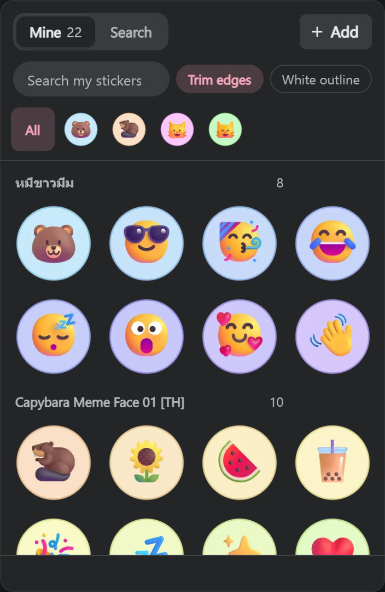

  

<h1 align="center">Custom Stickers for Messenger</h1>

Your images, GIFs, and favorite sticker packs in Messenger on desktop.

<strong>Chrome / Edge · Manifest V3 · No build step</strong>

  <a href="#install">Install</a> ·
  <a href="#use">Use</a> ·
  <a href="#troubleshooting">Troubleshooting</a> ·
  <a href="#limits">Limits</a> ·
  <a href="#permissions-and-privacy">Privacy</a> ·
  <a href="#how-it-works">How it works</a>

Custom Stickers adds a sticker picker beside Messenger's own picker. In supported **end-to-end encrypted chats**, it uses Messenger's sticker composer to send your image as a custom sticker, rather than pasting a link into the conversation.

| What you can do | How it works |
| --- | --- |
| Make your own stickers | Add a PNG, JPEG, WebP, GIF, APNG, or AVIF; paste or drop an image; optionally trim transparent edges and add a white outline. |
| Find more | Search GIPHY stickers or LINE Store packs, save one sticker, or save a whole LINE pack. |
| Collect from the web | Right-click an image on any website and choose **Add to my Messenger stickers**. |
| Use them in comments | Stage a sticker in a Facebook comment box, then post with Enter. Comment formats differ from chat stickers; see [Use](#use). |

## Preview

*The preview uses synthetic stickers in the local [panel test page](tools/panel-test.html), not a live Facebook chat.*

## Install

This is an unpacked extension; it is not listed in a browser store.

1. Download the extension ZIP from the [latest release](https://github.com/SnowiyQ/FbCustomStickers/releases/latest) and **extract it** into a folder you will keep. Alternatively, clone or download this repository; its root also contains `manifest.json`.
2. Open `chrome://extensions` in Chrome, or `edge://extensions` in Edge.
3. Enable **Developer mode**, choose **Load unpacked**, and select the folder that directly contains `manifest.json`.
4. Reload any Facebook or Messenger tabs already open. After an update, reload the extension on the extensions page, then reload the tabs.

[คู่มือการติดตั้งภาษาไทย](วิธีติดตั้ง.txt) · Keep the extracted folder: moving or deleting it breaks the unpacked installation.

## Use

### In a chat

Open an end-to-end encrypted chat on `facebook.com` or `messenger.com`. The new sticker button appears next to Messenger's own sticker button.

- **Search**: find GIPHY stickers or LINE Store packs. Click a result to send it; use **+** to save one or **Save pack** to keep a LINE pack.
- **Mine**: click a saved sticker to send it. Use **Add**, <kbd>Ctrl</kbd>+<kbd>V</kbd>, or drag and drop to import an image. **Trim edges** crops transparent padding; **White outline** adds a sticker-style border.
- **From another site**: right-click an image and choose **Add to my Messenger stickers**. A badge shows queued imports; they appear when a Facebook tab is open. On a LINE Store pack page, right-click the page to import the pack.

Static images are converted to WebP with a maximum side of 512 px. Animated formats are converted to animated WebP with a target size of about 900 KB; browser decoding support and the source image affect the result.

### In Facebook comments

The button also appears beside supported post comment boxes. Select a sticker to stage it, then press Enter to post. Facebook comments do **not** accept these as custom chat stickers: GIPHY and LINE items become linked GIF comments (inside Facebook's GIF frame), while images you imported yourself become photo comments with a white background.

## Troubleshooting

| Symptom | Try this |
| --- | --- |
| No button beside the sticker picker | Check that the extension is enabled, then reload the Facebook/Messenger tab. If you updated the files, reload the extension first. |
| Chat sticker cannot be sent | Check whether that chat is end-to-end encrypted. Custom sticker sending is not supported in other chats. |
| A web image or pack will not import | Check the browser's site-access permission for the extension. The image must be reachable and no larger than 15 MB; the source site may also block requests. |
| Search is empty or fails | GIPHY and LINE results depend on their current pages/endpoints. Try again later or import an image directly. |
| A comment is not a custom sticker | This is expected: comments use GIF/photo fallbacks, not Messenger's chat sticker format. |

## Limits

- This is an **unofficial** extension. Meta can change Messenger's internal composer at any time, so live compatibility is not guaranteed.
- Custom sticker sending is limited to supported end-to-end encrypted chats. The comment fallback is visibly different from a chat sticker.
- GIPHY search currently returns only its first page of sticker results. Telegram sticker packs are not supported.
- Your library is stored in this browser profile; it is not synced to your phone or other computers.
- The supported browsers here are Chrome and Edge. Other Chromium browsers may work but are not tested by this repository.

## Permissions and privacy

The manifest requests access to **all URLs** so the background worker can fetch an image you choose from any website, and so the right-click import can read a `blob:` image in its originating tab. The extension's content scripts run only on `www.facebook.com`, `web.facebook.com`, and `www.messenger.com`.

Your imported library and settings are stored in `chrome.storage.local`. Search and imports make requests to the selected source site (including GIPHY or LINE); sending a chat sticker lets Messenger upload it in the open conversation. The source contains no separate account, analytics service, or extension-owned upload server. The code is here so you can inspect exactly what runs.

## How it works

In an encrypted chat, Messenger's sticker callback can fetch an image URL and send its WebP data as a `StickerMessage`. The extension passes that callback a temporary `blob:` URL for your selected image. A separate bridge handles local storage and source-site requests because the page-world script cannot access `chrome.*` APIs directly.

| File | Role |
| --- | --- |
| [`src/page.js`](src/page.js) | Finds Messenger's sticker composer, renders the picker, converts images, and stages comment attachments. |
| [`src/bridge.js`](src/bridge.js) | Bridges picker messages to extension storage and the background worker. |
| [`src/background.js`](src/background.js) | Fetches GIPHY/LINE results and images, manages the right-click menus and queued imports. |
| [`tools/panel-test.html`](tools/panel-test.html) | Runs the picker against synthetic local data, without posting to Facebook. |

There are no runtime dependencies or build step. To check the JavaScript syntax, run `node --check src/background.js`, `node --check src/bridge.js`, and `node --check src/page.js`. To inspect the local UI test page, serve the repository (for example, `python -m http.server 8000`) and open `http://localhost:8000/tools/panel-test.html`; the `file://` version cannot exercise the message bridge reliably.

`python tools/package.py` creates the release ZIP in `dist/`. `python tools/make_icons.py` regenerates the PNG icons and requires Pillow; neither Python tool is needed to run the extension.
